# 1. ORM and the Conceptual Schema Design Procedure

[Contents](README.md) | Next: [2. Relational Mapping](02-rmapping.md)

---

In this unit, ORM stands for **Object Role Modelling**, not Object Relational Mapping. Keep this in mind if you search online, because most results for "ORM" are about programming libraries.

The **Conceptual Schema Design Procedure (CSDP)** has seven steps. IFB105 covers the first five:

1. Transform familiar examples into elementary facts.
2. Draw the fact types and apply a population check.
3. Check for entity types to be combined and note any arithmetic derivations.
4. Add uniqueness constraints and check the arity of fact types.
5. Add mandatory role constraints and check for logical derivations.

Steps 6 (value, set-comparison and subtyping constraints) and 7 (other constraints and final checks) are not assessed in this unit.

Here is the complete FitHub schema after all five steps. You don't need to understand it yet. Come back to it at the end of the chapter and you should be able to explain every part of it.

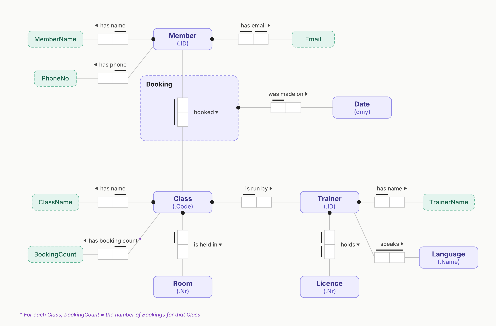

## Contents

- [Notation](#notation)
- [Step 1: Transform familiar examples into elementary facts](#step-1-transform-familiar-examples-into-elementary-facts)
- [Step 2: Draw the fact types and apply a population check](#step-2-draw-the-fact-types-and-apply-a-population-check)
- [Step 3: Combine entity types and note arithmetic derivations](#step-3-combine-entity-types-and-note-arithmetic-derivations)
- [Step 4: Add uniqueness constraints and check arity](#step-4-add-uniqueness-constraints-and-check-arity)
- [Step 5: Add mandatory role constraints and check for logical derivations](#step-5-add-mandatory-role-constraints-and-check-for-logical-derivations)
- [The finished FitHub schema](#the-finished-fithub-schema)

---

## Notation

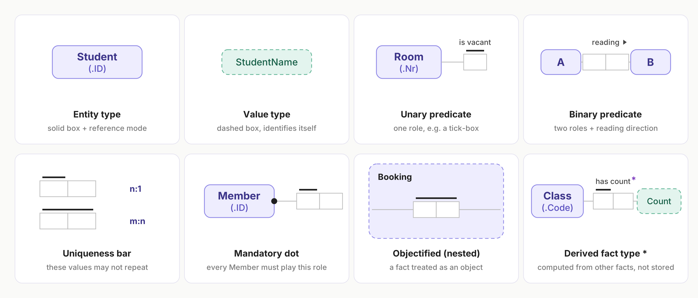

| Term | Meaning |
|---|---|
| **Object type** | Anything the model talks about. It is either an entity type or a value type. |
| **Entity type** | An object that can't identify itself, so it needs a **reference mode**, for example `Member (.ID)`. Drawn as a solid rounded box. |
| **Value type** | A constant that identifies itself, such as the string `'Ava Tran'` or the number `52`. **A value type never has a reference mode.** Drawn as a dashed box. |
| **Reference mode** | How an entity is identified, written in brackets with a leading dot: `(.ID)`, `(.Code)`, `(.Name)`. Reference modes based on a unit use a colon instead: `(AUD:)`, `(cm:)`, `(L:)`. |
| **Role** | One box in a predicate. It is the part an object plays in a fact. |
| **Predicate** | A sequence of roles with a reading, for example "… *has name* …". |
| **Arity** | The number of roles. Unary is 1, binary is 2 and ternary is 3. |

> **A unit-based reference mode makes an entity type.** `Price (AUD:)` and `Quantity (L:)` are drawn as solid entity boxes, because the unit tells you how to read the number. A plain name such as `ProductName` is a value type. You need this for practice exam Q18b.

---

## Step 1: Transform familiar examples into elementary facts

You start with real data (a form, a table or a screenshot) and rewrite each piece of information as a plain English sentence.

**Pattern:** entity type + reference mode + *has* / *is* + value type + value.

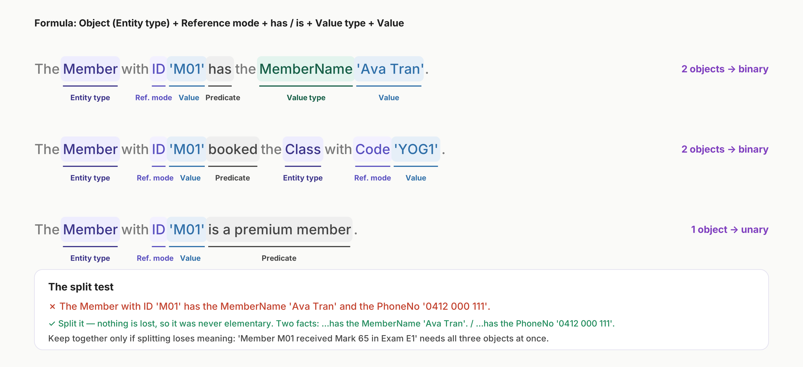

### What makes a fact elementary

An elementary fact:

1. **Can't be split** into smaller facts without losing information.
2. **States something that is true.** "Steven is not a patient" describes something that isn't the case, so it isn't an elementary fact.
3. **Has no conditions.** "If X then Y" or "X, so Y" is two facts joined by logic.

To check, try splitting the sentence in two. If nothing is lost, it was a compound fact and you should write it as two facts. If splitting loses meaning, keep it as one. "Member M01 received Mark 65 in Exam E1" has to stay together, because once you split it you no longer know which exam the 65 was for.

### Counting objects and finding the arity

Count the object types in the fact. Don't count values or reference modes. The number you get is the arity.

| Fact | Objects | Arity |
|---|---|---|
| The Member with ID 'M01' has the MemberName 'Ava Tran'. | Member, MemberName | 2, binary |
| The Member with ID 'M01' booked the Class with Code 'YOG1'. | Member, Class | 2, binary |
| The Member with ID 'M01' is a premium member. | Member | 1, unary |
| The Student 'N01' received a Mark of 65 on the Exam 'E1'. | Student, Mark, Exam | 3, ternary |

### Entity or value?

Ask yourself whether you need a reference mode to say which one you mean, or whether you'll record other facts about it. If so, it is an entity type. If it is a plain string or number that identifies itself, it is a value type.

- `Member`, `Class` and `Trainer` are entity types (identified by an ID or code).
- `MemberName` and `ClassName` are value types.
- **A tick-box on a form is a unary fact**, not a Yes/No value type. A ticked "Premium member" box becomes "The Member … is a premium member." If the box isn't ticked, you simply don't record the fact.

### Common mistakes

- Leaving out the reference mode. Write "The **Member with ID** 'M01' has…", not "M01 has…".
- Joining two facts with "and".
- Treating the reference mode (for example `StudentID`) as an object of its own.

### Practice exam questions

Which of these is an elementary fact?

(a) The Patient with PatientID "T1204" has the Phone Number "12345678" **and** the Email Address "p.davies@email.com". 
(b) The Person with the Name "Steven" is **not** a patient of this hospital. 
(c) The Employee with EmployeeID "E1235" has the Name "Elizabeth Smith". 
(d) The Employee "E1235" visited Sydney, **so** the Employee "E1523" visited Melbourne.

Answer

**(c).** You can split (a) into two facts without losing anything. (b) states something that is *not* true. (d) contains a condition ("so"). Only (c) is a single true fact that can't be split.

In "The Student with StudentID "N2345" received a Grade of 5 in the Unit with UnitCode "ABC123"", which is a **value type object**?

(a) Grade (b) StudentID (c) Unit (d) "ABC123"

Answer

**(a) Grade.** Grade has no reference mode, so it is a value type. StudentID is Student's *reference mode*, Unit is an *entity type* (identified by UnitCode), and "ABC123" is a *value*: a piece of data, not an object type.

What is the arity of "The Hotel Room with Number "1123" is vacant"?

Answer

**(a) Unary.** Hotel Room is the only object, and it plays one role (*is vacant*).

 

Count the objects in each fact.

| Fact | Your answer |
|---|---|
| The Employee with EmployeeID "E0123456" has the Job Title with Name "Associate Lecturer". | ? |
| The Student with StudentID "N014156" received a Mark of 65 on the Exam with ExamID "ABC123-2/2T1". | ? |
| The Device with AssetNumber "D854125" is unallocated. | ? |
| The Device with AssetNumber "D893665" is allocated to the Employee with EmployeeID "E0123456". | ? |

Answer

**2, 3, 1, 2.** The objects are (Employee, Job Title), (Student, Mark, Exam), (Device) and (Device, Employee). Reference modes and values don't count.

 

Write one elementary fact for each fact type in this product table.

| ProductID | ProductName | Price | Quantity | UnitPrice |
|---|---|---|---|---|
| PRO123512 | Sunshine Farms Apple Juice | $5.00 | 2L | $2.50 |
| PRO852852 | Duet Energy Drink | $4.00 | 500mL | $8.00 |

Answer

1. The Product with ProductID "PRO123512" has the ProductName "Sunshine Farms Apple Juice".
2. The Product with ProductID "PRO123512" has the Price $5.00.
3. The Product with ProductID "PRO123512" has the Quantity 2L.
4. The Product with ProductID "PRO123512" has the Unit Price $2.50.

There are four fact types, one for each non-key column. Notice that every fact follows the same pattern: entity type, reference mode, value.

---

## Step 2: Draw the fact types and apply a population check

Each elementary fact from Step 1 becomes a **fact type** on the diagram. Draw a box for each object type, a row of role boxes for the predicate, and a line from each role to the object that plays it. Add a **reading** with a small arrow showing which way to read it.

**Then do the population check.** Write a few rows of sample data under the role boxes, one column per role. This is the part of Step 2 that students skip most often, but you need it: Steps 4 and 5 are worked out from these columns.

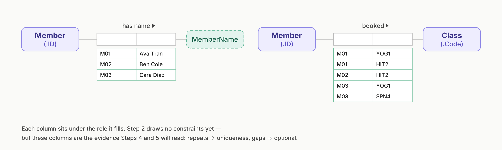

How to read the sample data:

- **A value repeats in a column:** that role is not unique. This tells you where the uniqueness bar goes in Step 4.
- **An object is missing from a column:** that role is optional (Step 5).
- **You can't fill in a row:** the fact type is wrong or isn't elementary. Go back to Step 1.

Use at least three rows, and include a repeat and a gap if the scenario allows it.

### Ternary facts and nesting

A fact with three objects is allowed. But when **facts are recorded about the relationship itself**, it is cleaner to **nest** it. Draw a rounded rectangle around the predicate, give it a noun as a name, and treat it as an object.

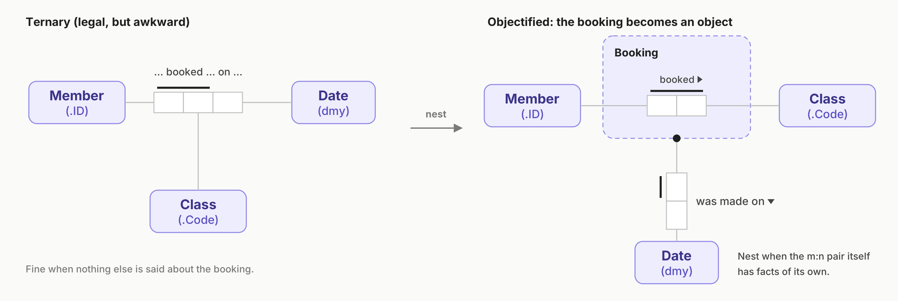

You'll usually see this with a many-to-many fact such as Member *booked* Class, where the data has extra columns that belong to the pair rather than to either object. The booking date belongs to M01's booking of YOG1, not to M01 or YOG1 on their own. You can only nest a fact type whose uniqueness bar spans both roles.

### Practice exam questions

 

Use your elementary facts from Q18a to complete Step 2.

Answer

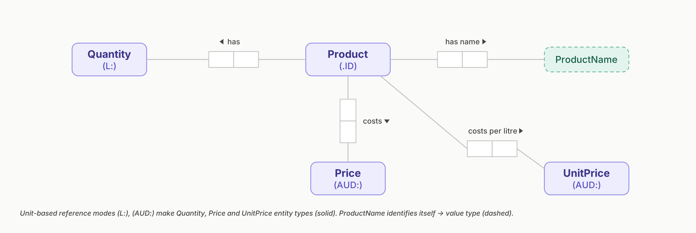

Check your answer against these three points:

- **Entity or value.** Quantity (L:), Price (AUD:) and UnitPrice (AUD:) have unit-based reference modes, so they are entity types (solid boxes). ProductName is a value type (dashed box).
- **No constraints yet.** Step 2 has no uniqueness bars and no mandatory dots, and you won't get marks for adding them.
- **Sample data.** The official answer only shows the fact types. It's still worth writing two rows of sample data under each predicate, because Step 2 is "draw the fact types **and apply a population check**".

---

## Step 3: Combine entity types and note arithmetic derivations

Step 3 asks two separate questions.

**Should any object types be combined?** Ask:

- Q1. Can the same entity belong to both types?
- Q2. Can entities of the two types be meaningfully compared?
- Q3. Is the same kind of information recorded for both, and would you ever list them together?

If the answer is yes, combine them into one type and keep the old distinction as a fact type or as role names.

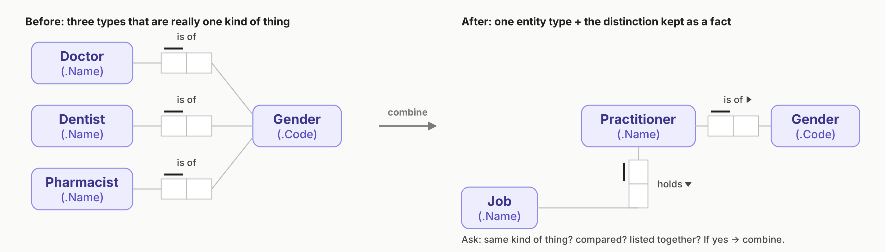

**Can any fact type be calculated from others?** If a value can be worked out from other stored values, mark the fact type with an asterisk (\*) and write the rule underneath. **Derived facts are not stored**, because storing something you can calculate is redundant.

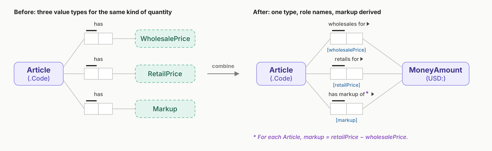

In this example the three price types have been combined into one `MoneyAmount (USD:)`. Role names in square brackets (`[wholesalePrice]`, `[retailPrice]` and `[markup]`) tell the three predicates apart. Whenever two or more predicates connect to the same object type, give the roles names.

> **In the exam:** in Q18, UnitPrice = Price ÷ Quantity (2 L for $5.00 is $2.50 per litre). If a question asked for Step 3, you would mark UnitPrice with \* and not store it. Q18 only asks for Steps 1 and 2, though, so leave it in. Answer the step the question asks for.

### Practice exam questions

 

Q20 includes a fact type "Installation *requires maintenance on* Date \*" with the rule *maintenanceDate = installationDate + 1 year*. What happens to it when you map the schema in chapter 2?

Answer

The asterisk and the rule tell you it is **derived**. It is calculated, not stored, so it does **not** become a column in the RMap.

---

## Step 4: Add uniqueness constraints and check arity

A **uniqueness constraint** is a bar over one or more roles. It means the values in that role, or in that combination of roles, can't repeat. It decides the multiplicity of the relationship.

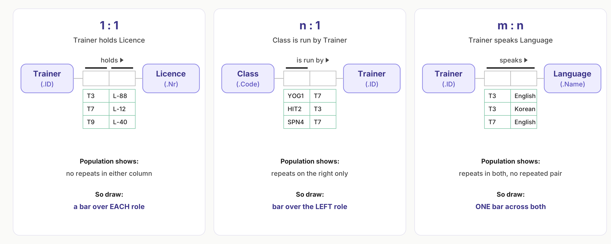

| Association | Example | What the sample data shows | What you draw |
|---|---|---|---|
| **1 : 1** | Trainer *holds* Licence | No repeats in either column | A separate bar over **each** role |
| **n : 1** | Class *is run by* Trainer | Repeats on one side only | One bar over the role that **never** repeats |
| **m : n** | Trainer *speaks* Language | Repeats in both columns, but the same pair never appears twice | **One** bar spanning both roles |

**Every binary fact type needs at least one uniqueness bar.** A binary fact type with no bar is wrong.

### The n-1 rule

> In a predicate with *n* roles, every uniqueness constraint must span at least *n* − 1 roles.

For a binary fact type (n = 2), the bar covers one role or both. For a ternary (n = 3), every bar must cover at least two roles:

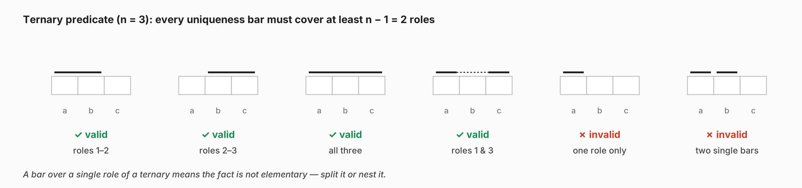

If a ternary has a bar over a single role, the fact wasn't elementary, so split it or nest it. A bar can skip a role (roles 1 and 3, drawn with a dotted gap in the middle). That still counts as two roles.

### Checking a constraint against data

Constraints are rules the database enforces, so a row that breaks one is rejected. Given a schema and some data, you should be able to say which constraint a new row would break. Q19 below tests exactly this.

### Practice exam questions

Which of these is a one-to-one association?

(a) One student may study many subjects; one subject has many students. 
(b) Every pet has at least one owner; one owner may have several pets. 
(c) A professor may teach many classes; each class is led by one professor. 
(d) Every patient has only one medical record; one medical record records only one patient.

Answer

**(d).** (a) and (b) are many-to-many, because neither side is limited to one. (c) is one-to-many. Only (d) is limited to one in both directions.

Four ternary predicates A–B–C are drawn with different uniqueness bars. Which one is incorrect?

Answer

**(b)**, the one with two *separate* bars that each cover a single role. It breaks the n-1 rule, because every bar on a ternary has to span at least two roles. The dotted bar over roles 1 and 3 in (d) is fine.

A hospital schema has these fact types:

- Patient *has name*
- Patient *is being seen by* Clinician (one bar spanning both roles)
- Clinician *specialises in* MedicalSpecialty (bar on Clinician's role)
- Patient *is assigned to* Bed (a separate bar on each role, and a dot on Patient)
- Bed *is in* Ward
- Bed *has integrated* Device (bar spanning both roles)

Which statement is true?

(a) A patient must be assigned to exactly one bed and each bed can have only one patient. 
(b) No beds can be unassigned. 
(c) Every patient is assigned to exactly one clinician, but a clinician may treat many patients. 
(d) The hospital has only one clinician per medical specialty.

Answer

**(a).** Two separate bars make Patient–Bed one-to-one, and the dot on Patient makes it mandatory for patients.

- (b) would need a dot on Bed's side, and there isn't one.
- (c) describes one-to-many, but the bar spans both roles, so the relationship is many-to-many.
- (d) describes one-to-one, but the bar is only on Clinician's role, so several clinicians can share a specialty.

 

Student *currently enrolled in* Degree has a dot on Student (**C1**) and a bar on Student's role only (**C2**). Student *has completed* Degree has one bar spanning both roles (**C3**).

Current data: *enrolled* (00001, IF49) and (00002, IN01); *completed* (00001, IN01).

Each query is applied to the original data. Does it execute, or which constraint does it violate?

| Query | Your answer |
|---|---|
| Add CurrentlyEnrolledIn 00003 IN01 | ? |
| Add CurrentlyEnrolledIn 00001 IF63 | ? |
| Delete CurrentlyEnrolledIn 00001 IF49 | ? |
| Add HasCompleted 00002 IF49 | ? |
| Add HasCompleted 00003 IN01 | ? |
| Add HasCompleted 00001 IN01 | ? |

Answer

| Query | Result | Why |
|---|---|---|
| Add CurrentlyEnrolledIn 00003 IN01 | **Executed** | 00003 is a new student and nothing repeats |
| Add CurrentlyEnrolledIn 00001 IF63 | **C2 violated** | 00001 is already enrolled, and C2 allows each student to appear only once |
| Delete CurrentlyEnrolledIn 00001 IF49 | **C1 violated** | 00001 would still be in the database (in HasCompleted) without being enrolled |
| Add HasCompleted 00002 IF49 | **Executed** | 00002 is enrolled and the pair is new |
| Add HasCompleted 00003 IN01 | **C1 violated** | 00003 would be in the database without being enrolled |
| Add HasCompleted 00001 IN01 | **C3 violated** | That exact pair already exists |

The C1 rows are the tricky ones. A mandatory dot means *every* student in the database has to play that role, including students who only appear in a different fact type.

---

## Step 5: Add mandatory role constraints and check for logical derivations

A **mandatory role constraint** is a solid dot where the role's line meets the object type. It means every instance of that object **must** play the role.

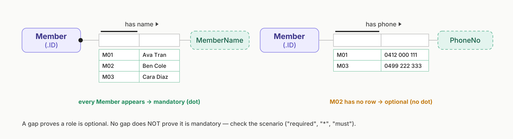

- **A gap in the sample data shows that a role is optional.**
- **No gap doesn't prove that a role is mandatory**, because the sample might be small. Look at the wording of the scenario instead. "Required", "must" or an asterisk on a form field means mandatory. "(Optional)" means no dot.
- Model what the system records, not what exists in the real world. Everyone has a date of birth, but if the organisation doesn't always collect it, the role is optional.

**Logical derivations.** Step 3 dealt with *arithmetic* derivations. Step 5 asks the same question about *logic*: can a fact type be worked out from other facts using a rule? For example, "\* Member is active iff that Member has at least one Booking." Mark it with \*, write the rule, and don't store it.

### Practice exam questions

 

Option (b) says "No beds can be unassigned." Why is this false?

Answer

There is no mandatory dot on Bed's side of *is assigned to*. Only Patient has the dot, so every patient must have a bed, but a bed can be empty.

 

Which queries break the mandatory constraint C1, and why?

Answer

"Delete CurrentlyEnrolledIn 00001 IF49" and "Add HasCompleted 00003 IN01". In both cases a student would be in the database (through *has completed*) without playing the mandatory *currently enrolled in* role.

---

## The finished FitHub schema

Practise reading each fact type and its constraints out loud. Most of the ORM questions in Section A ask you to do exactly this.

| Fact type | Uniqueness | Mandatory | In words |
|---|---|---|---|
| Member *has name* MemberName | Member's role | Member | Each member has exactly one name. Names can repeat. |
| Member *has phone* PhoneNo | Member's role | No | A member has at most one phone number and may have none. |
| Member *has email* Email | Each role separately (1:1) | Member | Each member has exactly one email, and no two members share one. |
| Member *booked* Class, nested as **Booking** | Spans both roles (m:n) | No | A class has many members and a member books many classes. |
| Booking *was made on* Date | Booking's role | Booking | Every booking has exactly one date. |
| Class *has name* ClassName | Class's role | Class | |
| Class *is run by* Trainer | Class's role | Class | Each class has one trainer, and a trainer can run many classes. |
| Class *is held in* Room | Class's role | Class | |
| Class *has booking count* \* | Class's role | No | **Derived**, so not stored. |
| Trainer *has name* TrainerName | Trainer's role | Trainer | |
| Trainer *holds* Licence | Each role separately (1:1) | Trainer | |
| Trainer *speaks* Language | Spans both roles (m:n) | No | |

---

[Contents](README.md) | Next: [2. Relational Mapping](02-rmapping.md)
