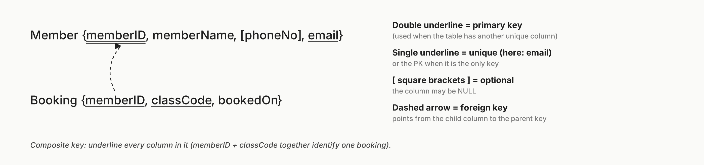
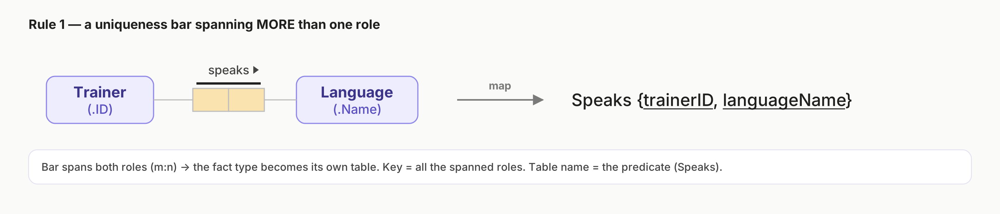
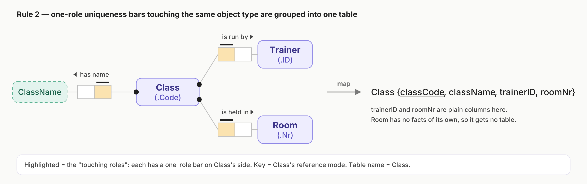
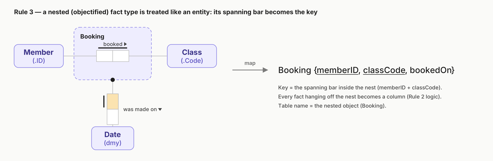
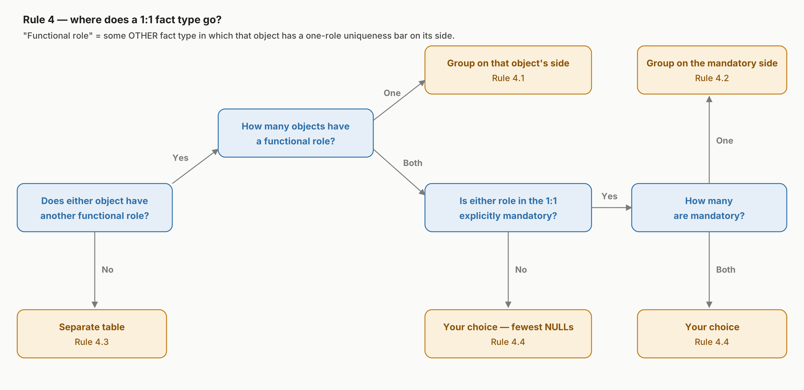
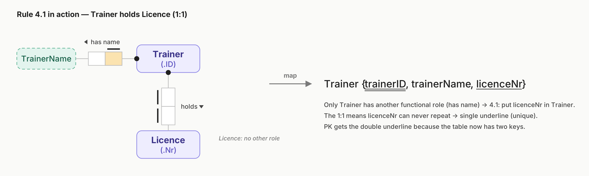
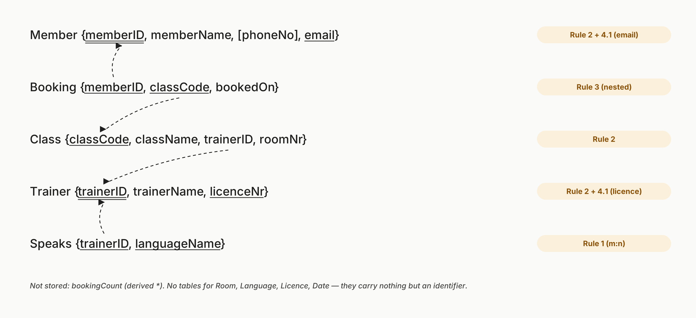
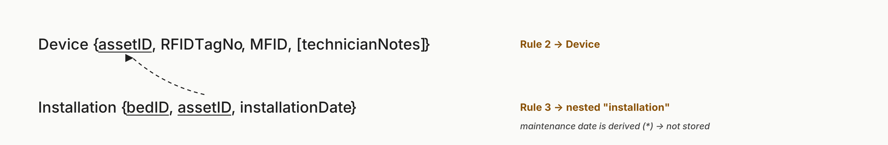

# 2. Relational Mapping (RMapping)


[Contents](README.md) | Previous: [1. ORM](01-orm.md) | Next: [3. Normalisation](03-normalisation.md)

---

## Contents

- [Why tables, and why more than one?](#why-tables-and-why-more-than-one)
- [Keys you need for RMapping](#keys-you-need-for-rmapping)
- [RMap syntax](#rmap-syntax)
- [The four rules](#the-four-rules)
- [The RMapping procedure, step by step](#the-rmapping-procedure-step-by-step)
- [FitHub, mapped](#fithub-mapped)
- [Practice exam questions](#practice-exam-questions)

---

## Why tables, and why more than one?

If you store everything in one big table, data gets repeated. A member's name and email are copied onto every one of their booking rows. That wastes space, but the bigger problem is **integrity**: if you change someone's email in one row and miss the others, the database contradicts itself. Ideally each row holds one elementary fact, and no fact is stored twice.

**Relational mapping (RMapping)** turns a finished ORM schema into a set of tables, called a *relational schema*, that avoids this problem from the start.

## Keys you need for RMapping

- **Primary key (PK):** the column or columns that uniquely identify each row.
- **Foreign key (FK):** a column in a *child* table whose values must match the primary key of a *parent* table. It enforces **referential integrity**, which means, for example, that you can't record a booking for a member who doesn't exist.

## RMap syntax



```
Student { studentID, name, email, [phoneNumber] }
Studies { studentID, unitID }
```

- `[Square brackets]` mark an optional column, which may be NULL.
- An underline marks a uniqueness constraint. A table can have more than one.
- A **double underline** marks the primary key when the table also has another underlined (unique) column. If there is only one underline, that is the primary key.
- A dashed arrow marks a foreign key. It points from the child column to the parent's key.

## The four rules

| Rule | Applies when | Result |
|---|---|---|
| **1** | A uniqueness bar spans **more than one role** | A separate table, named after the predicate. The primary key is the spanned roles. |
| **2** | Several **single-role** bars sit on the same object type | One table for that object, named after it. The primary key is its reference mode. |
| **3** | A fact type is **nested** (objectified) | Treat the nested fact type like an entity (as in Rule 2), named after the nesting. The primary key is its spanning bar. |
| **4** | A fact type is **one-to-one** | It goes in exactly one table. Rules 4.1 to 4.4 decide which. |

### Rule 1: uniqueness spanning more than one role



Examples from the lecture:

- *Student has studied Unit* becomes `HasStudied {studentNr, unitCode}`.
- A ternary *Person had Height in Year*, with a bar over Person and Year, becomes `HadIn {personName, year, heightCM}`.

### Rule 2: simple uniqueness constraints



The roles with a single-role bar on Class's side are Class's **functional roles** (the lecture also calls them "touching roles"). Each one becomes a column in the Class table.

Examples from the lecture: `Country {countryName, [populationNr], area}`, where population is optional and so in brackets, and `Race {raceNr, raceTime, [winner]}`.

**Derived roles are left out.** In the lecture's Playlist example, Playlist's only functional role was a derived runtime\*, so Playlist didn't get a table of its own.

### Rule 3: nested fact types



Examples from the lecture: `Work {employeeNr, projectName, startDate, [endDate]}` and `Supply {supplierNr, itemNr, quantity}`.

### Rule 4: one-to-one constraints

A one-to-one fact type goes into **only one** table. Which table depends on the other roles each object plays:



| Rule | Situation | Example from the lecture |
|---|---|---|
| **4.1** | Only one of the objects has another functional role. Put the fact in that object's table. | `Client {clientNr, gender, birthdate, [bankcardNr]}`, because Bankcard plays no other role |
| **4.2** | Both objects have other functional roles, and only one of the roles in the 1:1 is mandatory. Put the fact on the mandatory side. | `Bankcard {bankcardNr, expiryDate, clientNr}`, once Bankcard also has an expiry date and a mandatory dot |
| **4.3** | Neither object has another functional role. Make a separate table. | `HasTFN {clientCRN, taxFileNo}` |
| **4.4** | Both objects have functional roles, and both roles (or neither) are mandatory. You choose; pick the table that ends up with the **fewest NULLs**. | Employee drives Car: either `Employee {…, carRegNr}` or `Car {…, employeeNr}` |



> **Compare these two cases.** In the lecture's Playlist example, *User has email* is one-to-one, but User has **no other functional role**: its only other fact, *Playlist was created by User*, is many-to-many. So Rule 4.3 applies and you get a separate `HasEmail {username, emailAddress}` table. In FitHub, Member *also* has a name, so Rule 4.1 puts `email` in the Member table. The facts look the same, but a different rule applies because of the object's *other* roles.

## The RMapping procedure, step by step

1. **Cross out derived fact types (\*).** They aren't stored.
2. **Rule 1:** give every bar that spans two or more roles, and isn't nested, its own table.
3. **Rule 3:** give every nested fact type a table keyed on its spanning bar, with a column for each fact attached to it.
4. **Rule 2:** for each object type, collect its single-role-bar facts into one table keyed on its reference mode.
5. **Rule 4:** place each one-to-one fact type using the decision tree, and underline the column that isn't the key to mark it **unique**.
6. **Optional roles** (no dot) go in `[brackets]`.
7. **Drop any table that would hold only a key**, for an object with no facts of its own. In FitHub that means Room, Language, Licence and Date.
8. **Draw the foreign keys.** Every column that holds another table's key gets a dashed arrow.

## FitHub, mapped



---

## Practice exam questions


Map the hospital schema from [Q6](01-orm.md#step-4-add-uniqueness-constraints-and-check-arity) to tables (leave out foreign keys).

(a) `patient {patientID, clinicianEmpId, patientName, bedID}` · `clinician {empID, clinicianName, medicalSpecialty}` · `bed {bedID, deviceID, wardName}`<br>
(b) `beingSeenBy {patientID, clinicianEmpID}` · `integratedDevice {bedID, deviceID}` · `patient {patientID, patientName}` · `clinician {…}` · `bed {bedID, wardName, patientID}`<br>
(c) `beingSeenBy {…}` · `patient {patientID, patientName, bedID}` · `clinician {…}` · `bed {bedID, wardName, deviceID}`<br>
(d) `beingSeenBy {patientID, clinicianEmpID}` · `integratedDevice {bedID, deviceID}` · `patient {patientID, patientName, bedID}` · `clinician {empID, clinicianName, medicalSpecialty}` · `bed {bedID, wardName}`

<details><summary>Answer</summary>

**(d).** Going through the rules in order:

- **Rule 1:** *is being seen by* and *has integrated* both have bars spanning both roles, so they become `beingSeenBy {patientID, clinicianEmpID}` and `integratedDevice {bedID, deviceID}`.
- **Rule 2:** `patient {patientID, patientName}`, `clinician {empID, clinicianName, medicalSpecialty}` and `bed {bedID, wardName}`.
- **Rule 3:** there is no nesting.
- **Rule 4:** Patient–Bed is one-to-one, both objects have other functional roles, and only Patient's role is mandatory. Under **Rule 4.2**, `bedID` goes into `patient` and is marked unique.

(c) loses the many-to-many Bed–Device fact by squeezing `deviceID` into `bed`. (b) puts the one-to-one fact on Bed's side, which has no mandatory dot.

</details>

 

The schema has these fact types:

- Bed *has integrated* Device, nested as "Installation" (the bar spans both roles).
- Installation *was installed on* Date.
- Installation *requires maintenance on* Date, which is derived (\*).
- Device *is tracked using* RFID (.TagNo).
- Device *is manufactured by* Manufacturer (.MFID).
- Device *has* TechnicianNotes, which is optional.

Complete the RMap, including all keys and foreign keys.

<details><summary>Answer</summary>



- **Rule 1:** doesn't apply, because the only spanning bar is nested.
- **Rule 2:** `Device {assetID, RFIDTagNo, MFID, [technicianNotes]}`. The notes are optional, so they go in brackets.
- **Rule 3:** `Installation {bedID, assetID, installationDate}`. The maintenance date is derived, so it's left out.
- **Rule 4:** doesn't apply.
- **There is no Bed table**, because Bed has no facts apart from its ID. `Installation.assetID` is a foreign key to `Device.assetID`.

</details>

 

You need to read the case study RMap for Q22 and Q23. In `Customer {customerID, firstName, lastName, email, phoneNo}`, `email` and `phoneNo` are underlined. What does that mean for an INSERT?

<details><summary>Answer</summary>

They are **unique** columns. Inserting a customer with an email that already exists fails, even if the customerID is new. This is the first row of Q23.

</details>

---

[Contents](README.md) | Previous: [1. ORM](01-orm.md) | Next: [3. Normalisation](03-normalisation.md)
