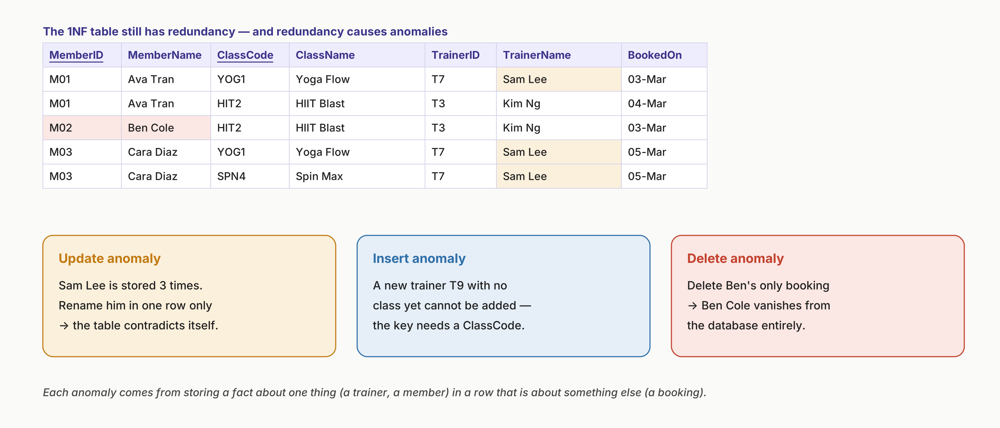
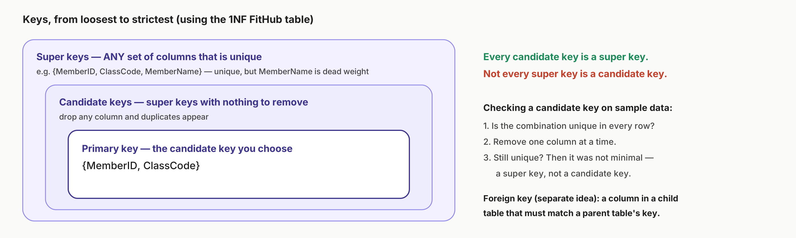
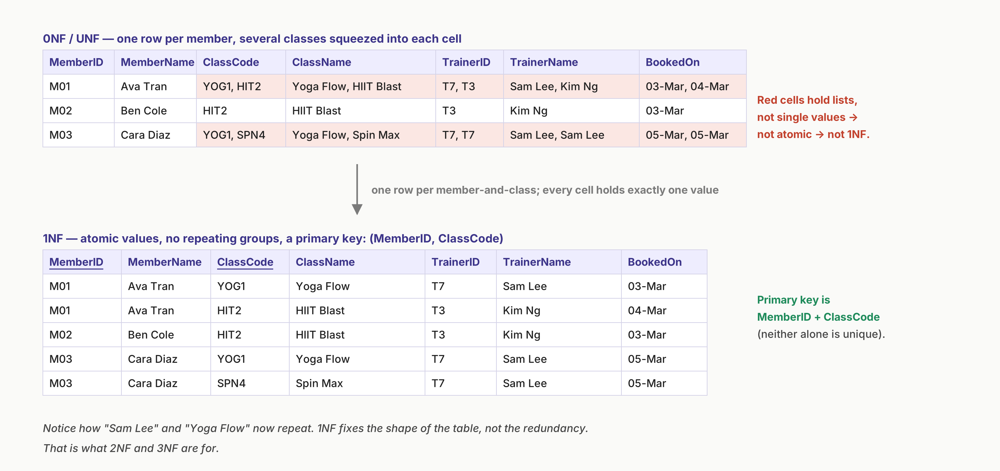
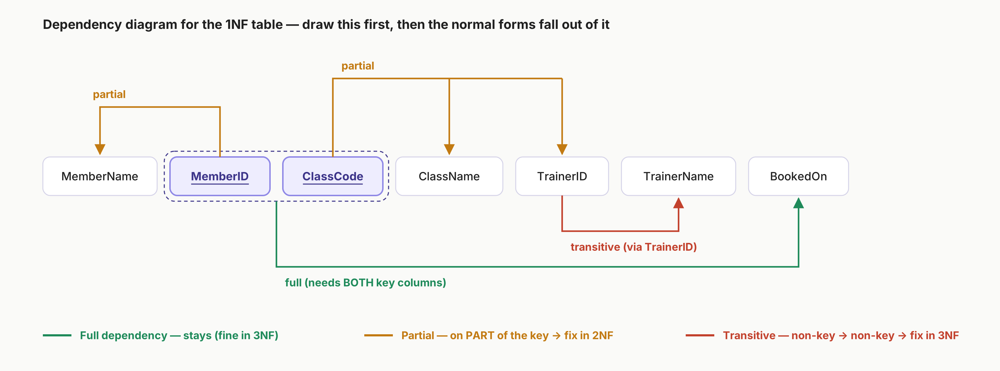
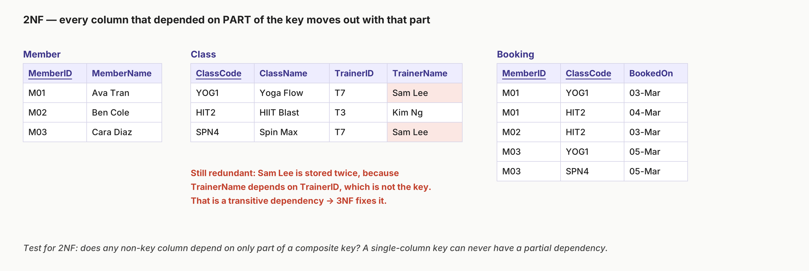
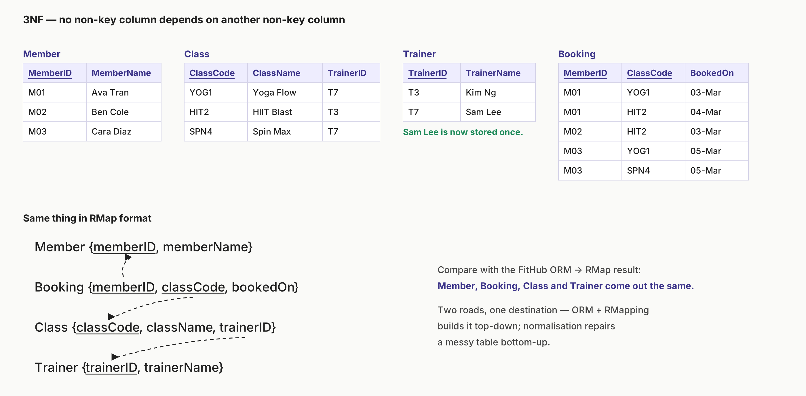
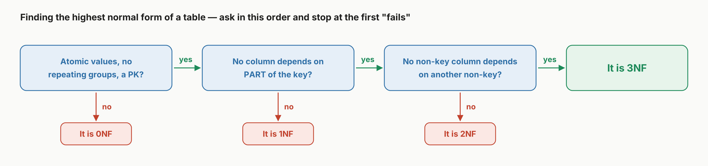
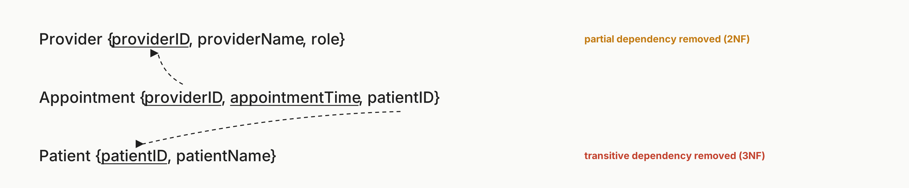

# 3. Normalisation

[Contents](README.md) | Previous: [2. Relational Mapping](02-rmapping.md) | Next: [4. SQL](04-sql.md)

---

## Contents

- [Why normalise? Anomalies](#why-normalise-anomalies)
- [Keys and dependencies](#keys-and-dependencies)
- [Step 1: First Normal Form (1NF)](#step-1-first-normal-form-1nf)
- [Draw the dependency diagram first](#draw-the-dependency-diagram-first)
- [Step 2: Second Normal Form (2NF)](#step-2-second-normal-form-2nf)
- [Step 3: Third Normal Form (3NF)](#step-3-third-normal-form-3nf)
- [Finding the highest normal form](#finding-the-highest-normal-form)

---

## Why normalise? Anomalies

**Normalisation** is a procedure for removing redundancy from tables. It's the second way to get to a good relational schema. ORM and RMapping build the tables from a model (top-down), while normalisation starts with an existing messy table and fixes it (bottom-up).

A badly structured table has three kinds of **anomaly**:

| Anomaly | What goes wrong | Example from the lecture |
|---|---|---|
| **Insertion** | You can't add some data without also adding unrelated data. | You can't add a new project, "Delta", until an employee is assigned to it. |
| **Deletion** | Deleting one thing also deletes facts about something else. | Deleting Bob's row also deletes the name and location of the "Beta" project. |
| **Update** | A fact stored in many rows gets changed in some of them but not others. | Renaming "Computer Science" in only one row leaves the data inconsistent. |

IFB105 covers the first three normal forms. Each one includes the one before it, so a table in 3NF is also in 2NF and 1NF.

## Keys and dependencies

- **Super key:** any set of columns whose combined values are unique.
- **Candidate key:** a super key that can't be made any smaller. Remove any column from it and duplicates appear.
- **Primary key:** the candidate key you choose to use.
- **Foreign key:** a column in a child table that refers to a key in a parent table. This is a different idea from the others, because it's about links between tables rather than uniqueness within one table.

**Functional dependency (A → B):** each value of A has exactly one value of B, so A *determines* B. For example, `StudentID → StudentName`. A dependency can involve several columns, as in `StudentID, UnitID → Grade`. It doesn't work in reverse.

**Partial dependency:** a column depends on only **part** of a composite primary key.

**Transitive dependency:** a non-key column depends on **another non-key column** (key → A → B).

> [!WARNING]
> **Work out dependencies from the data, not from the column order.** To test whether X determines Y, find two rows with the same X. If they have different Y values, X does *not* determine Y. Don't treat names as identifiers either: in the practice exam, two different patients are both called "Mary Smith".

### Practice exam questions

True or false: every super key is a candidate key, but not every candidate key is a super key.

Answer

**False.** It's the other way round. Every candidate key is a super key, because it's unique. Not every super key is a candidate key, because some super keys can be made smaller and still be unique.

Which of these is a candidate key for the table below?

(a) (DoctorID, WardName) (b) PatientID (c) (PatientID, WardName) (d) (PatientID, WardName, DoctorID)

| PatientID | PatientName | WardName | DoctorID | DoctorName |
|---|---|---|---|---|
| P1235 | Mary Smith | Paediatrics | E1232 | Esther Simpson |
| P1263 | Mary Smith | Ophthalmology | E1956 | Holly Brown |
| P1214 | Jess Last | Paediatrics | E1232 | Esther Simpson |
| P2353 | Jake Hart | Paediatrics | E1539 | Owen Roberts |
| P1214 | Jess Last | Ophthalmology | E1235 | Owen Marchant |

Answer

**(c).**

- (a) is out, because (Paediatrics, E1232) appears twice.
- (b) is out, because P1214 appears twice.
- (c) is always unique, and you can't remove either column without getting duplicates.
- (d) is unique too, but you can remove DoctorID and it's still unique. That makes it a super key, not a candidate key.

True or false: a primary key is used in the child table to reference a row in the parent table.

Answer

**False.** That is the definition of a **foreign key**.

---

## Step 1: First Normal Form (1NF)

> [!IMPORTANT]
> A table is in **1NF** when:
>
> 1. It has a **primary key**, so every row can be uniquely identified.
> 2. Each column holds **one data type**.
> 3. Every value is **atomic**. There are no lists or repeating groups, and nothing that can be meaningfully divided further.

**How to get there:** remove repeating groups by giving each repeated item its own row, and make every value atomic. Then find the primary key.

> [!NOTE]
> **Whether a value is atomic depends on context.** The lecture treats a full address ("123 Maple St, Springfield, IL, 62704") as non-atomic, because it combines the street, city, state and ZIP code, so you would split it into separate columns. A person's name is usually treated as atomic.

## Draw the dependency diagram first

Before you try 2NF or 3NF, list every functional dependency in the 1NF table and label each one. Doing this first makes the next two steps much more straightforward.

FitHub's 1NF table has the key (MemberID, ClassCode):

- MemberID → MemberName is **partial** (it depends on only half the key).
- ClassCode → ClassName, TrainerID is **partial**.
- TrainerID → TrainerName is **transitive** (key → ClassCode → TrainerID → TrainerName).
- (MemberID, ClassCode) → BookedOn is **full** (it needs both columns).

## Step 2: Second Normal Form (2NF)

> [!IMPORTANT]
> A table is in **2NF** when it is in 1NF **and has no partial dependencies**. Every non-key column depends on the *whole* primary key.

**How to get there:** move each partially dependent column into a new table, together with the part of the key it depends on. That part of the key becomes the new table's primary key, and stays in the original table as a foreign key.

> [!TIP]
> **Shortcut:** 2NF only matters when the primary key is **composite**. A table in 1NF with a single-column primary key is automatically in 2NF.

## Step 3: Third Normal Form (3NF)

> [!IMPORTANT]
> A table is in **3NF** when it is in 2NF **and no non-key column depends on another non-key column**. In other words, there are no transitive dependencies.

**How to get there:** move the transitively dependent columns into a new table, keyed on the column they actually depend on. Keep that column in the original table as a foreign key.

These four 3NF tables are the same Member, Booking, Class and Trainer tables that RMapping produced from the FitHub ORM schema in [chapter 2](02-rmapping.md#fithub-mapped). Both methods end up with the same design.

### The lecture's worked example: Client Rental

Start with a single `ClientRental` table (clientNo, cName, propertyNo, pAddress, rentStart, rentFinish, rent, ownerNo, oName).

- **1NF:** `ClientRental {clientNo, propertyNo, cName, pAddress, rentStart, rentFinish, rent, ownerNo, oName}`
- **2NF:** `ClientRental {clientNo, propertyNo, rentStart, rentFinish}` · `Client {clientNo, cName}` · `Property {propertyNo, pAddress, rent, ownerNo, oName}`
- **3NF:** split out the transitive dependency propertyNo → ownerNo → oName, giving `Property {propertyNo, pAddress, rent, ownerNo}` · `Owner {ownerNo, oName}`

## Finding the highest normal form

### Practice exam questions

What is the highest normal form of this table? (0NF, 1NF, 2NF or 3NF)

| StoreID | ProductID | Price | ManagerID | ManagerName |
|---|---|---|---|---|
| Syd2021 | PR0001 | $12.00 | E12322 | Angela Smith |
| Syd2021 | PR0002 | $16.00 | E12322 | Angela Smith |
| Syd2022 | PR0001 | $10.00 | E12362 | Gabby Blueman |
| Bris2025 | PR0001 | $10.00 | E12321 | Audrey Slim |
| … | … | … | … | … |

Answer

**(b) 1NF.** The values are atomic, each column has one type, and there is a primary key: (StoreID, ProductID). But ManagerID and ManagerName depend on StoreID alone. That's a **partial** dependency, so the table isn't in 2NF.

Normalise this table to 3NF (leave out foreign keys).

| BookID | BookTitle | LoanedTo | AuthorID | AuthorName |
|---|---|---|---|---|
| P1235 | I Cut the Headlights | LC12301234 | E1232 | Amelia Sims |
| P1235 | I Cut the Headlights | LC12301234 | E1956 | Guy Brennan |
| P1935 | Summer's a Knife | | E1232 | Amelia Sims |
| P2353 | Devils Roll the Dice | LC12120123 | E1539 | Peter Richards |
| P1214 | Angels Roll their Eyes | | E1539 | Peter Richards |

(a) `Book{BookID, BookTitle, [LoanedTo]}` · `Author{AuthorID, AuthorName}` · `Authorship{BookID, AuthorID}` 
(b) `Book{BookID, BookTitle, LoanedTo}` · `Author{AuthorID, AuthorName, BookID}` 
(c) `Book{BookID, BookTitle, LoanedTo, AuthorID}` · `Author{AuthorID, AuthorName}` 
(d) `Book{BookID, BookTitle, [LoanedTo], [AuthorID]}` · `Author{AuthorID, AuthorName}`

Answer

**(a).**

- LoanedTo has gaps, so it has to be optional. That rules out (b) and (c).
- AuthorID is never empty, so it isn't optional. That rules out (d).
- Book–Author is many-to-many (P1235 has two authors, and E1232 wrote two books), so it needs its own `Authorship` table.

Use the patient table from [Q12](#keys-and-dependencies), with the primary key (PatientID, DoctorID). Which statement is true?

(a) WardName is dependent on PatientID. 
(b) DoctorID is dependent on WardName. 
(c) PatientID is dependent on WardName. 
(d) PatientName is partially dependent on the primary key.

Answer

**(d).** Every row with P1214 has the name Jess Last, so PatientID → PatientName. PatientID is only *part* of the key, so this is a partial dependency.

(a) is false because P1214 appears with two different wards. (b) and (c) fail for the same reason: Paediatrics appears with several doctors and several patients. Don't let the column order mislead you.

 

The primary key is (ProviderID, AppointmentTime). Normalise the table to 3NF and write it in RMap format, including all keys and foreign keys.

| ProviderID | ProviderName | Role | AppointmentTime | PatientID | PatientName |
|---|---|---|---|---|---|
| CL1231 | Anna Riordan | GP | 20 May 8:00 | PA73481 | Ben Rider |
| CL2365 | Calvin Bridge | Nurse | 20 May 8:00 | PA73481 | Ben Rider |
| CL4523 | Eddy Lewis | GP | 20 May 8:00 | PA67235 | Fran Jones |
| CL2365 | Calvin Bridge | Nurse | 20 May 8:15 | PA67235 | Fran Jones |
| … | … | … | … | … | … |

Answer

**The table starts in 1NF.** ProviderName and Role depend on ProviderID alone, which are partial dependencies. Fixing them gives 2NF:

- `Provider {providerID, providerName, role}`
- `Appointment {providerID, appointmentTime, patientID, patientName}`

**This still isn't 3NF**, because patientName depends on patientID, which is a non-key column (a transitive dependency). Split it out:

---

[Contents](README.md) | Previous: [2. Relational Mapping](02-rmapping.md) | Next: [4. SQL](04-sql.md)
