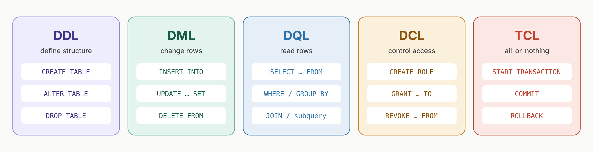
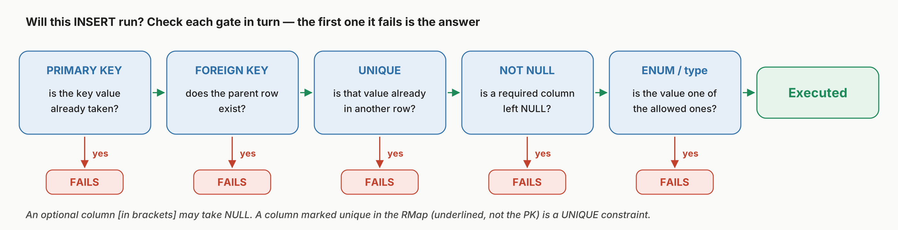
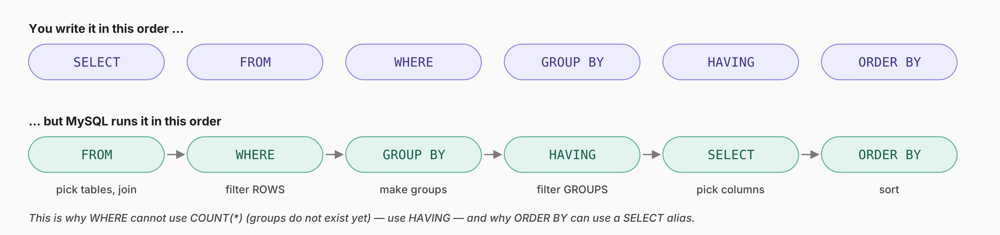
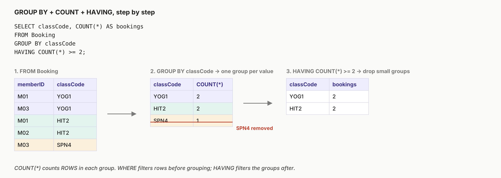
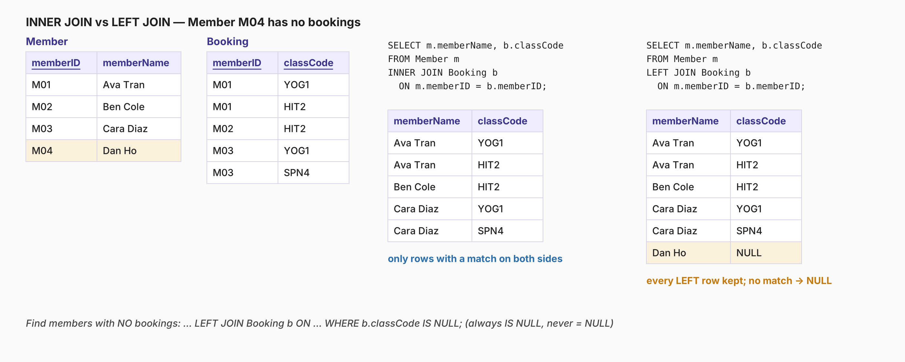
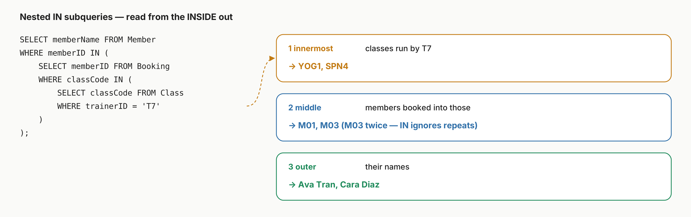

<div align="center">

# 4. SQL


[Contents](README.md) | Previous: [3. Normalisation](03-normalisation.md) | Next: [5. CARE principles](05-care-principles.md)

</div>

---

All the SQL in this chapter runs as written in MySQL Workbench. Open [`sql/fithub.sql`](sql/fithub.sql) and try each example as you go.



## Contents

- [4.1 DDL: creating tables from an RMap](#41-ddl-creating-tables-from-an-rmap)
- [4.2 DML: inserting, updating and deleting rows](#42-dml-inserting-updating-and-deleting-rows)
- [4.3 Querying with SELECT](#43-querying-with-select)
- [4.4 Aggregates, GROUP BY and HAVING](#44-aggregates-group-by-and-having)
- [4.5 Joins](#45-joins)
- [4.6 Subqueries and set operators](#46-subqueries-and-set-operators)
- [4.7 TCL and DCL: transactions and permissions](#47-tcl-and-dcl-transactions-and-permissions)
- [Common SQL mistakes](#common-sql-mistakes)

---

## 4.1 DDL: creating tables from an RMap

Once you know how each part of an RMap translates, writing the `CREATE TABLE` statements is mechanical:

| RMap | SQL |
|---|---|
| Underlined key | `PRIMARY KEY` (for a composite key, add `PRIMARY KEY (a, b)` at the end) |
| No brackets | `NOT NULL` |
| `[Brackets]` | Allowed to be NULL (leave `NOT NULL` off) |
| Underlined, but not the primary key | `UNIQUE` |
| Dashed arrow | `FOREIGN KEY (col) REFERENCES Parent(col)` |
| A fixed list of values | `ENUM('A', 'B', 'C')` |
| A number the system generates | `INT AUTO_INCREMENT` |

```sql
CREATE TABLE Member (
  memberID    VARCHAR(5)   PRIMARY KEY,
  memberName  VARCHAR(50)  NOT NULL,
  phoneNo     VARCHAR(15),                    -- [optional] in the RMap, so NULL is allowed
  email       VARCHAR(80)  NOT NULL UNIQUE    -- underlined in the RMap, so UNIQUE
);

CREATE TABLE Trainer (
  trainerID   VARCHAR(5)   PRIMARY KEY,
  trainerName VARCHAR(50)  NOT NULL,
  licenceNr   VARCHAR(10)  NOT NULL UNIQUE
);

CREATE TABLE Class (
  classCode   VARCHAR(6)   PRIMARY KEY,
  className   VARCHAR(50)  NOT NULL,
  trainerID   VARCHAR(5)   NOT NULL,
  roomNr      INT          NOT NULL,
  FOREIGN KEY (trainerID) REFERENCES Trainer(trainerID)
);

CREATE TABLE Booking (
  memberID    VARCHAR(5)   NOT NULL,
  classCode   VARCHAR(6)   NOT NULL,
  bookedOn    DATE         NOT NULL,
  PRIMARY KEY (memberID, classCode),
  FOREIGN KEY (memberID)  REFERENCES Member(memberID),
  FOREIGN KEY (classCode) REFERENCES Class(classCode)
);
```

**Create parent tables before child tables.** `Class` refers to `Trainer`, so `Trainer` has to exist first, and `Booking` comes last.

**Changing a table:**

```sql
ALTER TABLE Member ADD COLUMN memberType ENUM('Standard', 'Premium') NOT NULL DEFAULT 'Standard';
ALTER TABLE Member DROP COLUMN memberType;
DROP TABLE Booking;            -- drop child tables before parent tables
```

### Practice exam questions

 

Fill in the blanks to create the case study's Ticket table.

```sql
CREATE TABLE Ticket (
    ticketID INT [A] AUTO_INCREMENT,
    eventID  INT [B],
    orderID  INT [C],
    category [D]('Child', 'Adult', 'VIP', 'Concession'),
    seatNo   VARCHAR(15),
    [E] (orderID) [F] Orders(orderID),
    [G] (eventID) [H] Event(eventID)
);
```

<details><summary>Answer</summary>

| Blank | Answer |
|---|---|
| A | `PRIMARY KEY` |
| B | `NOT NULL` |
| C | `NOT NULL` |
| D | `ENUM` |
| E | `FOREIGN KEY` |
| F | `REFERENCES` |
| G | `FOREIGN KEY` |
| H | `REFERENCES` |

B and C are NOT NULL because eventID and orderID aren't in brackets in the RMap. category and seatNo *are* in brackets, so they can be NULL.

</details>

---

## 4.2 DML: inserting, updating and deleting rows

```sql
INSERT INTO Member VALUES ('M04', 'Dan Ho', NULL, 'dan@mail.com');                -- every column, in order
INSERT INTO Member (memberID, memberName, email) VALUES ('M05', 'Eve Lam', 'eve@mail.com');  -- named columns only

UPDATE Member SET phoneNo = '0400111222' WHERE memberID = 'M02';
DELETE FROM Booking WHERE memberID = 'M03' AND classCode = 'SPN4';
```

> [!WARNING]
> **Always include a `WHERE` clause on UPDATE and DELETE.** Without one, every row in the table changes. MySQL Workbench's *safe update mode* blocks an UPDATE or DELETE whose WHERE clause doesn't use a key column. If you really need to run one, turn safe mode off with `SET SQL_SAFE_UPDATES = 0;`.

### Will this statement run?

Exam questions often ask whether an INSERT will succeed. Check it against each constraint in turn:



Some examples using the FitHub data:

| Statement | Result |
|---|---|
| `INSERT INTO Member VALUES ('M01', 'Eve Lam', NULL, 'eve@mail.com');` | **Fails.** `M01` is already a primary key value. |
| `INSERT INTO Booking VALUES ('M09', 'YOG1', '2026-03-06');` | **Fails.** Foreign key: there is no member M09. |
| `INSERT INTO Member VALUES ('M05', 'Eve Lam', NULL, 'ava@mail.com');` | **Fails.** UNIQUE: another member already has that email. |
| `INSERT INTO Member VALUES ('M05', NULL, NULL, 'eve@mail.com');` | **Fails.** memberName is NOT NULL. |
| `DELETE FROM Trainer WHERE trainerID = 'T3';` | **Fails.** T3 still runs a class, so child rows exist. Delete or reassign them first. |
| `INSERT INTO Booking VALUES ('M04', 'YOG1', '2026-03-06');` | **Executes.** |

### Practice exam questions


Red Velvet Records is moving. Which query updates the Customers table correctly?

(a) `ALTER Customers UPDATE Address = '19 Albert Street' WHERE CustomerID = 'CU091214'`<br>
(b) `SET Address = '19 Albert Street' FROM Customers WHERE CustomerID = 'CU091214';`<br>
(c) `UPDATE Customers SET Address = '19 Albert Street' WHERE CustomerID = 'CU091214';`<br>
(d) `MODIFY Address = '19 Albery Street' FROM Customers WHERE CustomerID = 'CU091214';`

<details><summary>Answer</summary>

**(c).** ALTER changes a table's *structure*, not the data in it. (b) is missing UPDATE. MODIFY isn't a valid command on its own (and (d) also misspells the address).

</details>

 

Using the case study, say whether each command fails or executes.

| Query | Your answer |
|---|---|
| `INSERT INTO Customer VALUES (5, 'Ivy', 'Lee', 'i.lee@email.com', '0412121212');` | ? |
| `INSERT INTO Ticket VALUES (15, 2, 3, 'Child', NULL);` | ? |
| `INSERT INTO Event VALUES (5, 'Strawberry Sunrise: The Punnet Squares Tour', 'Cornetto Stadium', NULL, 'Concert');` | ? |
| `INSERT INTO Extras VALUES (5, 6, 'Popcorn', 4, NULL);` | ? |
| `INSERT INTO Orders VALUES (5, 1, 66.00);` | ? |

<details><summary>Answer</summary>

| Query | Result | Why |
|---|---|---|
| Customer (5, 'Ivy', 'Lee', 'i.lee@email.com', …) | **Fails** | email is unique, and customer 4 already uses this one |
| Ticket (15, 2, 3, 'Child', NULL) | **Executes** | The primary key is new, event 2 and order 3 exist, 'Child' is an allowed value, and seatNo is optional |
| Event (5, …) | **Fails** | eventID 5 already exists (and dateTime isn't optional either) |
| Extras (5, 6, …) | **Fails** | Foreign key: there is no order 6 |
| Orders (5, 1, 66.00) | **Fails** | orderID 5 already exists |

I ran every one of these statements against the case study database in [`sql/practice_exam_case_study.sql`](sql/practice_exam_case_study.sql) to check.

</details>

---

## 4.3 Querying with SELECT

```sql
SELECT memberName FROM Member WHERE phoneNo IS NULL;               -- Ben Cole, Dan Ho
SELECT memberName FROM Member WHERE memberName LIKE 'C%';          -- Cara Diaz
SELECT DISTINCT classCode FROM Booking ORDER BY classCode;         -- HIT2, SPN4, YOG1
SELECT * FROM Class WHERE roomNr BETWEEN 1 AND 2;
SELECT * FROM Booking WHERE classCode IN ('YOG1', 'SPN4');
```

| Operator | Use |
|---|---|
| `=`, `<>`, `<`, `>=` | Compare single values |
| `IN (…)` | Match any value in a list or a subquery |
| `BETWEEN a AND b` | A range that includes both ends |
| `LIKE 'C%'` | Pattern matching: `%` matches any number of characters, `_` matches exactly one |
| `IS NULL` / `IS NOT NULL` | The **only** way to test for NULL. `= NULL` never matches anything. |
| `DISTINCT` | Remove duplicate rows from the result |
| `ORDER BY col DESC` | Sort the result (ascending is the default) |

### The order a query actually runs in



## 4.4 Aggregates, GROUP BY and HAVING

`COUNT`, `SUM`, `AVG`, `MIN` and `MAX` turn many rows into one value. Add `GROUP BY` to get one value for each group.



```sql
-- Bookings per trainer, busiest first
SELECT t.trainerName, COUNT(*) AS bookings
FROM Trainer t
JOIN Class   c ON c.trainerID = t.trainerID
JOIN Booking b ON b.classCode = c.classCode
GROUP BY t.trainerID, t.trainerName
ORDER BY bookings DESC;                  -- Sam Lee 3, Kim Ng 2
```

- **WHERE** filters rows *before* they are grouped. **HAVING** filters groups *after* grouping. Writing `WHERE COUNT(*) > 2` gives an error.
- `COUNT(*)` counts rows. `COUNT(column)` counts only the rows where that column is **not NULL**. For example, `SELECT COUNT(*), COUNT(phoneNo) FROM Member;` returns 4 and 2.
- Every column in SELECT that isn't inside an aggregate function should also be in GROUP BY.

### Practice exam questions


What does this query return?

```sql
SELECT bookID, COUNT(*) AS total_loans
FROM loans
GROUP BY bookID
ORDER BY total_loans DESC;
```

<details><summary>Answer</summary>

**(d).** It returns how many times each bookID appears in `loans`, which is the number of times each book has been borrowed, with the most borrowed first.

</details>

 

Return the first name, last name and email of every customer whose purchases add up to more than $100.

<details><summary>Answer</summary>

```sql
SELECT firstName, lastName, email
FROM Customer
WHERE customerID IN (
    SELECT customerID FROM Orders
    GROUP BY customerID
    HAVING SUM(totalPrice) > 100
);
```

This returns **Holly Richardson** (126.30 + 64.00 = 190.30) and **Mel Clunes** (356.25). A JOIN works too:

```sql
SELECT c.firstName, c.lastName, c.email
FROM Customer c JOIN Orders o ON o.customerID = c.customerID
GROUP BY c.customerID, c.firstName, c.lastName, c.email
HAVING SUM(o.totalPrice) > 100;
```

Either way, the idea is the same: add up the totals for each customer with GROUP BY and SUM, then filter those totals with HAVING.

</details>

---

## 4.5 Joins

A join combines rows from two tables wherever a condition matches. Usually the condition is a foreign key equal to a primary key.



```sql
-- Members who have never made a booking
SELECT m.memberName
FROM Member m
LEFT JOIN Booking b ON m.memberID = b.memberID
WHERE b.classCode IS NULL;             -- Dan Ho
```

- **INNER JOIN** keeps only the rows that have a match in both tables.
- **LEFT JOIN** keeps every row from the left table. Where there is no match, the columns from the right table are NULL.
- Give tables short aliases (`Member m`) and put the alias in front of any column name that appears in both tables (`m.memberID`).

## 4.6 Subqueries and set operators

A subquery is a SELECT inside another statement. When you see a subquery with `IN`, read it **from the inside out**:



```sql
-- Classes that M01 has NOT booked
SELECT className FROM Class
WHERE classCode NOT IN (SELECT classCode FROM Booking WHERE memberID = 'M01');   -- Spin Max

-- EXCEPT: rows in the first result that aren't in the second (MySQL 8.0.31 and later)
SELECT memberID FROM Member
EXCEPT
SELECT memberID FROM Booking;           -- M04
```

`UNION` combines two results and removes duplicates, `UNION ALL` keeps the duplicates, and `EXCEPT` takes the second result away from the first. Both sides must return the same number of columns.

### Practice exam questions

 

Using the case study, write down exactly what each query returns.

```sql
-- (1)
SELECT firstName, lastName FROM Customer
WHERE customerID IN (
   SELECT customerID FROM Orders
   WHERE orderID IN (SELECT DISTINCT orderID FROM Ticket WHERE category = 'VIP'));

-- (2)
SELECT orderID FROM Ticket GROUP BY orderID HAVING COUNT(*) > 2
EXCEPT
SELECT orderID FROM Orders WHERE totalPrice < 100;

-- (3)
SELECT DISTINCT Extras.orderID FROM Extras
INNER JOIN Ticket ON Ticket.orderID = Extras.orderID
WHERE Ticket.category = 'Child';

-- (4)
SELECT totalPrice FROM Orders
LEFT JOIN Extras ON Orders.orderID = Extras.orderID
WHERE Extras.notes IS NULL AND quantity IS NOT NULL;
```

<details><summary>Answer</summary>

| Query | Returns | Working |
|---|---|---|
| (1) | **Holly Richardson** | The VIP tickets belong to order 4, order 4 belongs to customer 1, and customer 1 is Holly Richardson. |
| (2) | **3** | Orders with more than 2 tickets are 1, 3 and 5. Orders under $100 are 1, 4 and 5. Taking the second set away from the first leaves 3. |
| (3) | **5** | Orders 2 and 5 have extras, but only order 5 has Child tickets. |
| (4) | **59.00** | Only Extras row 2 (order 5, soft drink) has a NULL note and a quantity. Orders with no extras have a NULL quantity, so they're excluded. |

I checked all four by running them against the case study data.

> In the printed paper, query (3) is written with a lowercase `extras.orderID`. That works in MySQL Workbench on Windows and macOS, where table names aren't case-sensitive. On a Linux server it fails with "Unknown column", because table names are case-sensitive there. In your own answers, write table names with the same capitalisation as the table.

</details>

---

## 4.7 TCL and DCL: transactions and permissions

**Transactions (TCL)** group several changes so that they all happen or none of them do.

```sql
START TRANSACTION;
INSERT INTO Booking VALUES ('M04', 'SPN4', '2026-03-07');
UPDATE Member SET phoneNo = '0400999888' WHERE memberID = 'M04';
COMMIT;          -- make the changes permanent
-- or ROLLBACK;  -- undo everything since START TRANSACTION
```

> [!CAUTION]
> **DDL commits automatically.** In MySQL, `CREATE`, `ALTER` and `DROP` trigger an implicit COMMIT. If you put an `ALTER TABLE` inside a transaction, everything before it is committed straight away, and a later `ROLLBACK` can't undo it. I tested this: an UPDATE followed by an ALTER was still there after the ROLLBACK. Keep changes to table structure out of transactions.

**Permissions (DCL).** MySQL 8 roles let you group privileges together and grant them all at once:

```sql
CREATE ROLE 'frontdesk', 'manager';

GRANT SELECT ON fithub.* TO 'frontdesk';                   -- can read every table
GRANT INSERT, UPDATE ON fithub.Booking TO 'frontdesk';     -- can manage bookings only
GRANT ALL PRIVILEGES ON fithub.* TO 'manager';

CREATE USER 'sam'@'localhost' IDENTIFIED BY 'a-strong-password';
GRANT 'frontdesk', 'manager' TO 'sam'@'localhost';         -- one user with two roles
SET DEFAULT ROLE ALL TO 'sam'@'localhost';                 -- turn the roles on at login

REVOKE UPDATE ON fithub.Booking FROM 'frontdesk';
```

A user with two roles has every privilege from both roles combined. To let someone add and edit rows but not remove them, grant `SELECT, INSERT, UPDATE` and leave out `DELETE`.

## Common SQL mistakes

> [!WARNING]
> - Strings go in single quotes (`'M01'`). Numbers don't.
> - Test for NULL with `IS NULL`, never `= NULL`.
> - Use `HAVING` for conditions on aggregates and `WHERE` for conditions on rows.
> - `COUNT(*)` counts rows. `COUNT(col)` skips NULLs.
> - Use `IN` with a subquery that might return several rows. Only use `=` when it returns exactly one.
> - `UPDATE` or `DELETE` without `WHERE` affects every row.
> - Create parent tables before child tables, and drop child tables before parent tables.
> - `ALTER` changes the structure of a table. `UPDATE` changes the data in it.

---

[Contents](README.md) | Previous: [3. Normalisation](03-normalisation.md) | Next: [5. CARE principles](05-care-principles.md)
