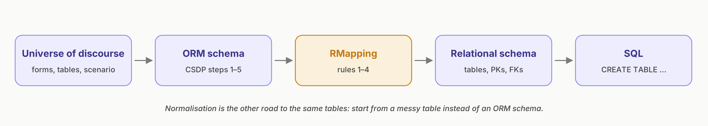

# IFB105 Database Management: Exam Study Guide

Prepared by Minh Kha (Marvin) Truong, SSP.

Based on the IFB105 Week 5 (RMapping) and Week 6 (Normalisation) lectures, the ORM revision note, and the IFB105 Practice Exam (Sections A and B) and its answer key.

---

## How to use this guide

Each chapter explains one topic and then goes through the practice exam questions on it. Try each question yourself before you look at the answer. Answers are hidden until you click **Answer**.

The questions are tagged so you can see where they come from:

| Tag | Meaning |
|---|---|
|  | Multiple choice question from Section A of the practice exam |
|   | Written question from Section B, with the marks available |
|  | A question from an earlier section, looked at again from a different angle |
|  | Part of a question that is answered in full in a later chapter |

All the chapters use the same example, **FitHub**, a small gym where members book classes run by trainers. In chapter 1 you model FitHub in ORM. In chapter 2 you map that model to tables. In chapter 3 you get the same tables again by normalising a messy spreadsheet, and in chapter 4 you build and query the database in SQL. Following one example the whole way through makes it much easier to see how the topics connect.

## Chapters

| | Chapter | Covers |
|---|---|---|
| 1 | [ORM and the Conceptual Schema Design Procedure](01-orm.md) | Elementary facts, fact types, population checks, uniqueness and mandatory constraints (CSDP steps 1 to 5) |
| 2 | [Relational Mapping](02-rmapping.md) | RMap syntax, the four mapping rules, keys and foreign keys |
| 3 | [Normalisation](03-normalisation.md) | Anomalies, keys, functional dependencies, 1NF, 2NF and 3NF |
| 4 | [SQL](04-sql.md) | DDL, DML, SELECT, GROUP BY and HAVING, joins, subqueries, transactions and permissions |
| 5 | [Data ethics: the CARE principles](05-care-principles.md) | Section B Q16 |

## SQL scripts

The [`sql/`](sql/) folder has two scripts you can run in MySQL Workbench:

- [`fithub.sql`](sql/fithub.sql) builds the FitHub database and contains every SQL example from chapter 4.
- [`practice_exam_case_study.sql`](sql/practice_exam_case_study.sql) builds the ticketing database from the practice exam case study, so you can check your answers to Q22 to Q25.

---

## Practice exam question index

| Question | Topic | Chapter |
|---|---|---|
| A · Q1 | Elementary facts | [ORM, Step 1](01-orm.md#step-1-transform-familiar-examples-into-elementary-facts) |
| A · Q2 | Entity vs value types | [ORM, Step 1](01-orm.md#step-1-transform-familiar-examples-into-elementary-facts) |
| A · Q3 | Arity | [ORM, Step 1](01-orm.md#step-1-transform-familiar-examples-into-elementary-facts) |
| A · Q4 | One-to-one associations | [ORM, Step 4](01-orm.md#step-4-add-uniqueness-constraints-and-check-arity) |
| A · Q5 | The n-1 rule | [ORM, Step 4](01-orm.md#step-4-add-uniqueness-constraints-and-check-arity) |
| A · Q6 | Reading constraints | [ORM, Step 4](01-orm.md#step-4-add-uniqueness-constraints-and-check-arity) and [Step 5](01-orm.md#step-5-add-mandatory-role-constraints-and-check-for-logical-derivations) |
| A · Q7 | RMapping | [RMapping](02-rmapping.md#practice-exam-questions) |
| A · Q8 | Super keys and candidate keys | [Normalisation, keys](03-normalisation.md#keys-and-dependencies) |
| A · Q9 | Highest normal form | [Normalisation](03-normalisation.md#finding-the-highest-normal-form) |
| A · Q10 | Normalising to 3NF | [Normalisation](03-normalisation.md#finding-the-highest-normal-form) |
| A · Q11 | Partial dependency | [Normalisation](03-normalisation.md#finding-the-highest-normal-form) |
| A · Q12 | Candidate key | [Normalisation, keys](03-normalisation.md#keys-and-dependencies) |
| A · Q13 | Foreign key | [Normalisation, keys](03-normalisation.md#keys-and-dependencies) |
| A · Q14 | GROUP BY and COUNT | [SQL 4.4](04-sql.md#44-aggregates-group-by-and-having) |
| A · Q15 | UPDATE | [SQL 4.2](04-sql.md#42-dml-inserting-updating-and-deleting-rows) |
| B · Q16 | CARE principles | [CARE](05-care-principles.md) |
| B · Q17 | Counting objects | [ORM, Step 1](01-orm.md#step-1-transform-familiar-examples-into-elementary-facts) |
| B · Q18 | CSDP steps 1 and 2 | [ORM, Step 1](01-orm.md#step-1-transform-familiar-examples-into-elementary-facts) and [Step 2](01-orm.md#step-2-draw-the-fact-types-and-apply-a-population-check) |
| B · Q19 | Constraint violations | [ORM, Step 4](01-orm.md#step-4-add-uniqueness-constraints-and-check-arity) and [Step 5](01-orm.md#step-5-add-mandatory-role-constraints-and-check-for-logical-derivations) |
| B · Q20 | RMapping with nesting and a derived fact | [RMapping](02-rmapping.md#practice-exam-questions) |
| B · Q21 | Normalising to 3NF | [Normalisation](03-normalisation.md#finding-the-highest-normal-form) |
| B · Q22 | CREATE TABLE | [SQL 4.1](04-sql.md#41-ddl-creating-tables-from-an-rmap) |
| B · Q23 | Which INSERTs fail | [SQL 4.2](04-sql.md#42-dml-inserting-updating-and-deleting-rows) |
| B · Q24 | GROUP BY and HAVING | [SQL 4.4](04-sql.md#44-aggregates-group-by-and-having) |
| B · Q25 | Subqueries, EXCEPT and joins | [SQL 4.5](04-sql.md#45-joins) and [4.6](04-sql.md#46-subqueries-and-set-operators) |

---

## Night-before checklist

**ORM**
- [ ] I write elementary facts with the entity type, reference mode and value every time.
- [ ] I can count the objects in a fact and name its arity.
- [ ] I know a tick-box is a unary fact, and a unit such as (AUD:) makes an entity type.
- [ ] I can tell 1:1, n:1 and m:n apart from the bars, and I can spot a bar that breaks the n-1 rule.
- [ ] I know a dot means mandatory, and a gap in the population means optional.
- [ ] I mark derived facts with \* and never store them.

**RMapping**
- [ ] Rule 1: a bar over two or more roles gets its own table. Rule 2: group by object. Rule 3: nested fact types. Rule 4: the one-to-one decision tree.
- [ ] Brackets for optional columns, underline for unique, double underline for the primary key when there is another unique column, dashed arrows for foreign keys.
- [ ] An object with nothing but an identifier doesn't get a table.

**Normalisation**
- [ ] 1NF: atomic values, no repeating groups, has a primary key.
- [ ] 2NF: no partial dependencies (these can only happen with a composite key).
- [ ] 3NF: no transitive dependencies.
- [ ] I test dependencies against the data and never treat names as keys.

**SQL**
- [ ] I can turn an RMap into CREATE TABLE statements with PRIMARY KEY, FOREIGN KEY, NOT NULL, UNIQUE and ENUM.
- [ ] I can explain why an INSERT fails: primary key, foreign key, UNIQUE, NOT NULL or ENUM.
- [ ] I can work through GROUP BY and HAVING, INNER and LEFT JOIN, nested IN and EXCEPT by hand.

Good luck!
